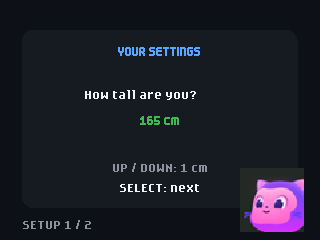
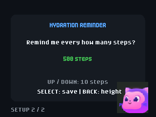
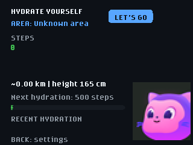
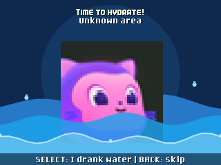
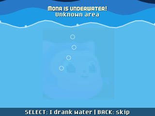

# Hydrate Yourself

Hydrate Yourself estimates your steps and prompts you to log hydration at a chosen step interval.

## Usage

On first launch, set your height and the number of steps between hydration
reminders with UP and DOWN; press SELECT to continue and save. Defaults are
165 cm and 500 steps. Press BACK from the main screen to change these settings.
Carry the badge while walking; the accelerometer estimates steps and the
screen shows an approximate distance based on your height. At each step
milestone, drink something and press SELECT to log the hydration. The step
count, settings, and five most recent hydration records are saved locally.
The dashboard displays the latest hydration record.
Hydration reminders show a full-screen Mona scene with animated water waves.
Press BACK during a reminder to skip it without logging a drink; the next
reminder stays at the next configured step milestone. Each consecutive skip
raises the water, with Mona submerged after three skips. The level stays
capped at three, is saved across reopening, and resets when you confirm a
drink with SELECT. Skipping briefly shows the rising water before returning
to the step counter. This is a playful visual, not a medical assessment.

| Screen | Controls |
| --- | --- |
| Height setup | UP/DOWN: change height by 1 cm (100-220 cm); SELECT: next |
| Reminder setup | UP/DOWN: change interval by 10 steps (100-5,000); BACK: height; SELECT: save |
| Step counter | BACK: settings; HOME: badge menu |
| Hydration reminder | SELECT: log a drink and reset water; BACK: skip |

Changing the interval schedules the next reminder at the next multiple of
that interval above your current step count. The badge counts steps only
while this app is open. Progress is saved every 25 steps and when a reminder
or hydration action occurs; up to 24 recent steps can be lost when exiting.
Hydration records contain a step count and an area name, not a wall-clock
timestamp or a quantity of liquid.

## Requirements

Requires Universe 2026 firmware with the standard graphics, IMU, and
`badgeware.State` APIs. No Wi-Fi credentials, internet connection, or extra
hardware are needed for step counting or hydration reminders.

The app listens for the same GHU infrared area beacons used by the Quest app.
It records a location only when a recognized beacon was detected within the
last minute; otherwise the record is marked **Unknown area**. Wi-Fi does not
provide precise indoor positioning here. IR beacon support depends on the
firmware library and beacons being present at the venue.

Step counting and distance are estimates based on motion and a step length of
about 41.5% of height. The simulator can check the interface, but cannot
validate real walking, infrared reception, or step-count accuracy.
Height affects the distance estimate, not the motion-detection threshold.
Choose reminder intervals for your own preferences; the app does not determine
your fluid needs.

## Screenshots

Captured at 320x240 in the Badge Simulator; reminder and water-level states
were triggered for illustration, not by walking.

| Height setup | Reminder setup |
| --- | --- |
|  |  |

| Step counter | Hydration reminder |
| --- | --- |
|  |  |

## Testing and installation

See [the testing and deployment guide](docs/TESTING.md) for simulator checks,
USB installation, and physical step-count and infrared acceptance checks.

## Credits

Mona artwork is reused from `badge/apps/quest/assets/mona.png` in this
MIT-licensed repository. The IR address, command mapping, and event area names
follow the existing Quest app. The water-cup icon was created for this app.
